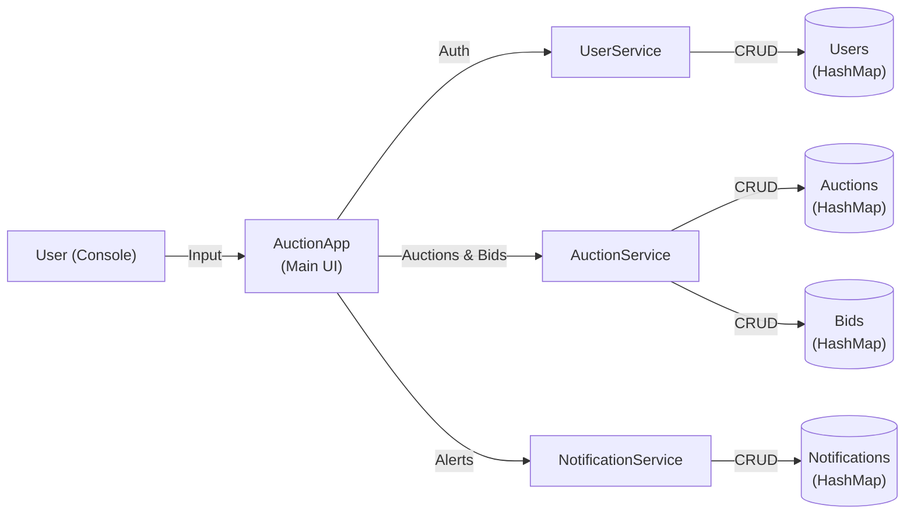
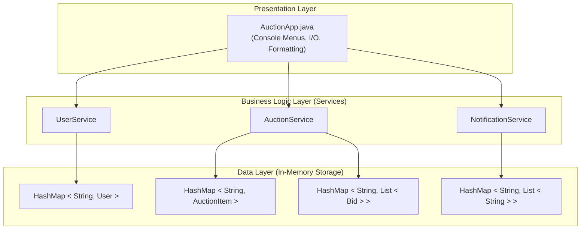
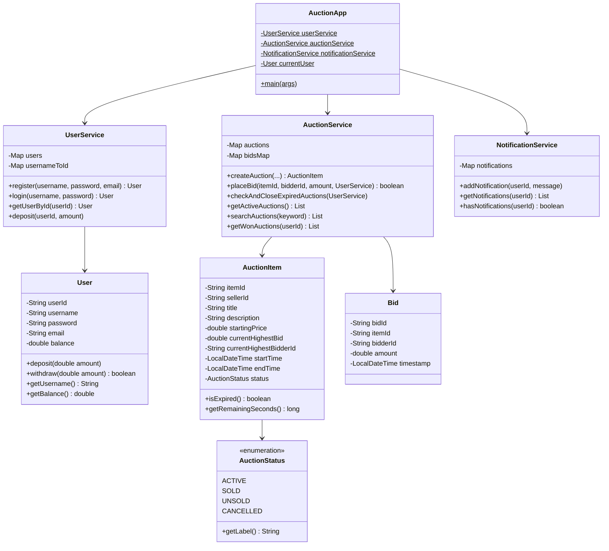
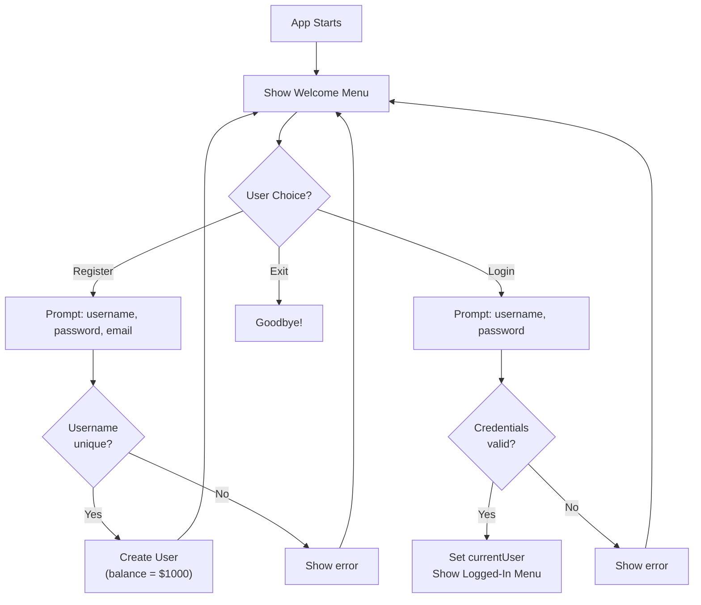
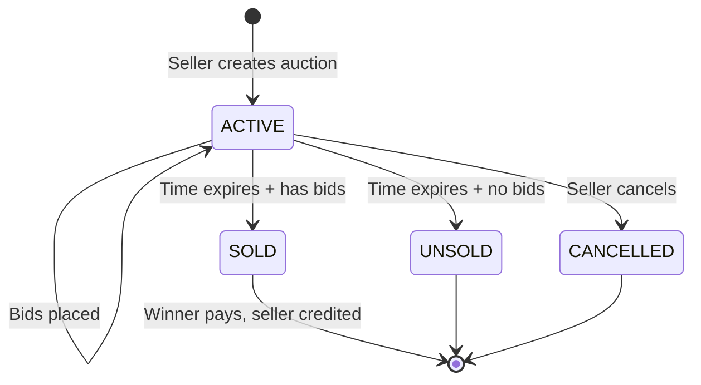
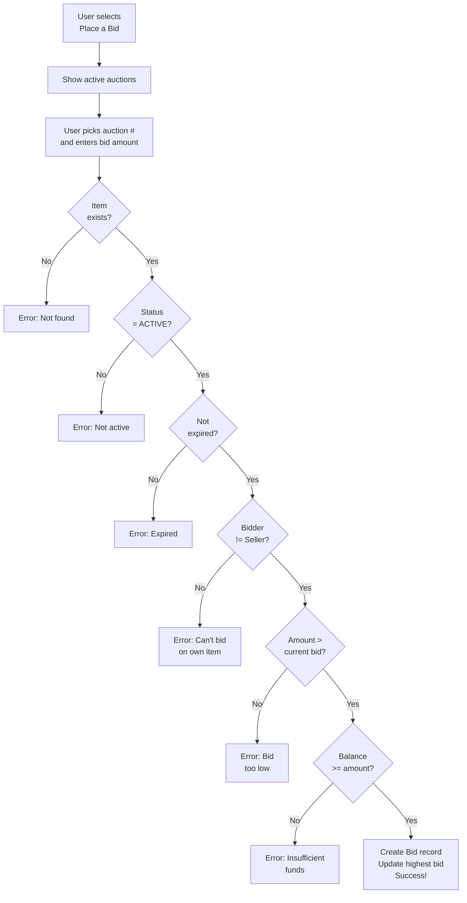
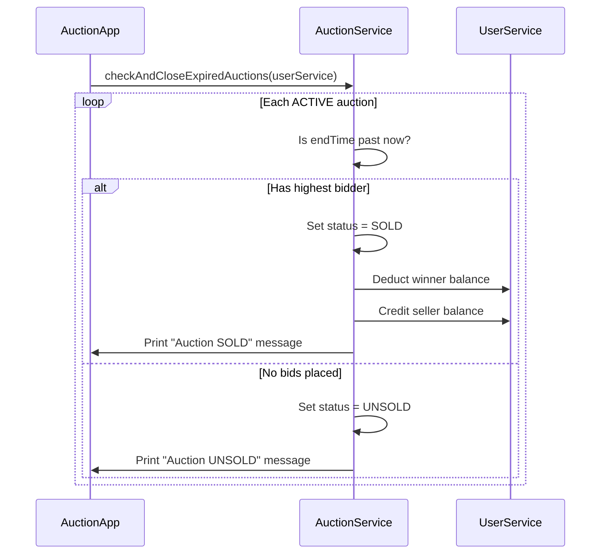

# Online Auction System - Architecture Document

> **Project**: Online Auction System (Console-Based)
> **Language**: Java (JDK 8+)
> **Storage**: In-Memory (HashMap / ArrayList)
> **Author**: Adithya

---

## 1. System Overview

The Online Auction System is a console-based Java application that simulates a real-time auction platform. Users can register, list items for sale, place bids, and win auctions — all through an interactive text menu.



---

## 2. Project Structure

```
Java Auction/
|-- src/
|   |-- AuctionApp.java         # Main entry point & console UI
|   |-- User.java               # User model (data class)
|   |-- AuctionItem.java        # Auction item model
|   |-- Bid.java                # Bid model
|   |-- AuctionStatus.java      # Enum: ACTIVE, SOLD, UNSOLD, CANCELLED
|   |-- UserService.java        # User registration, login, wallet
|   |-- AuctionService.java     # Auction CRUD, bidding, expiration
|   |-- NotificationService.java# In-memory notification store
|-- bin/                         # Compiled .class files
|-- ARCHITECTURE.md              # This file
```

---

## 3. Layered Architecture

The system follows a **3-layer architecture**:



| Layer | Responsibility | Files |
|-------|---------------|-------|
| **Presentation** | Console I/O, menus, formatting, input validation | `AuctionApp.java` |
| **Business Logic** | Core rules — auth, bidding validation, expiration, wallet ops | `UserService`, `AuctionService`, `NotificationService` |
| **Data / Model** | Plain Java objects + in-memory HashMap storage | `User`, `AuctionItem`, `Bid`, `AuctionStatus` |

---

## 4. Class Diagram



---

## 5. Application Flow

### 5.1 User Authentication Flow



### 5.2 Auction Lifecycle



### 5.3 Bidding Flow



> [!IMPORTANT]
> Balance is **not deducted** when a bid is placed. It is only deducted from the winner when the auction expires and is marked as **SOLD**.

### 5.4 Auction Expiration (Auto-Close)



---

## 6. Data Models

### 6.1 User

| Field | Type | Description |
|-------|------|-------------|
| `userId` | `String` (UUID) | Unique identifier |
| `username` | `String` | Login name (unique) |
| `password` | `String` | Password (plain text for simplicity) |
| `email` | `String` | Email address |
| `balance` | `double` | Wallet balance (default: $1000) |

### 6.2 AuctionItem

| Field | Type | Description |
|-------|------|-------------|
| `itemId` | `String` (UUID) | Unique auction ID |
| `sellerId` | `String` | User ID of the seller |
| `title` | `String` | Item title |
| `description` | `String` | Item description |
| `startingPrice` | `double` | Minimum starting price |
| `currentHighestBid` | `double` | Current top bid |
| `currentHighestBidderId` | `String` | User ID of top bidder |
| `startTime` | `LocalDateTime` | When auction started |
| `endTime` | `LocalDateTime` | When auction ends |
| `status` | `AuctionStatus` | ACTIVE / SOLD / UNSOLD / CANCELLED |

### 6.3 Bid

| Field | Type | Description |
|-------|------|-------------|
| `bidId` | `String` (UUID) | Unique bid ID |
| `itemId` | `String` | Which auction this bid is for |
| `bidderId` | `String` | User ID of the bidder |
| `amount` | `double` | Bid amount |
| `timestamp` | `LocalDateTime` | When the bid was placed |

---

## 7. Key Features

| Feature | Description |
|---------|-------------|
| **User Registration** | Create account with unique username, get $1000 starting balance |
| **User Login** | Authenticate with username + password |
| **Create Auction** | List an item with title, description, starting price, and duration |
| **Browse Auctions** | View all currently active auctions in a formatted table |
| **Search Auctions** | Find auctions by keyword (title or description) |
| **Place Bid** | Bid on active auctions with full validation |
| **Auto-Expiration** | Auctions auto-close when time runs out |
| **Wallet System** | Each user has a balance; deposit funds anytime |
| **Won Auctions** | View all auctions you've won |
| **Bid History** | View complete bid history for any auction |
| **Notifications** | In-memory notification system |
| **Demo Data** | Pre-seeded users (alice, bob) and auctions for testing |

---

## 8. How to Compile & Run

```bash
# Compile all source files
javac -d bin src/*.java

# Run the application
java -cp bin AuctionApp
```

### Demo Credentials (Pre-Seeded)

| Username | Password | Starting Balance |
|----------|----------|-----------------|
| `alice`  | `pass123` | $1000.00 |
| `bob`    | `pass456` | $1000.00 |

---

## 9. Design Decisions & Trade-offs

| Decision | Rationale |
|----------|-----------|
| **In-memory storage** | Keeps the project simple; no database setup required. Data resets on restart. |
| **No packages** | All files in one directory for easy compilation and understanding. |
| **UUID for IDs** | Guarantees uniqueness without a database sequence. |
| **Balance not deducted on bid** | Only the winner pays — prevents locking funds for losing bidders. |
| **Console-based UI** | Focuses on Java logic rather than GUI frameworks. |
| **Services pattern** | Separates business logic from UI, making it testable and maintainable. |

---

## 10. Possible Enhancements (Future Scope)

- **Database persistence** (MySQL / SQLite via JDBC)
- **GUI** using JavaFX or Swing
- **Multi-threading** for real-time auction countdowns
- **Password hashing** (BCrypt)
- **Email notifications** (JavaMail API)
- **Admin panel** for managing users and auctions
- **Category system** for auction items
- **Image upload** for auction listings
- **REST API** with Spring Boot for web-based access

