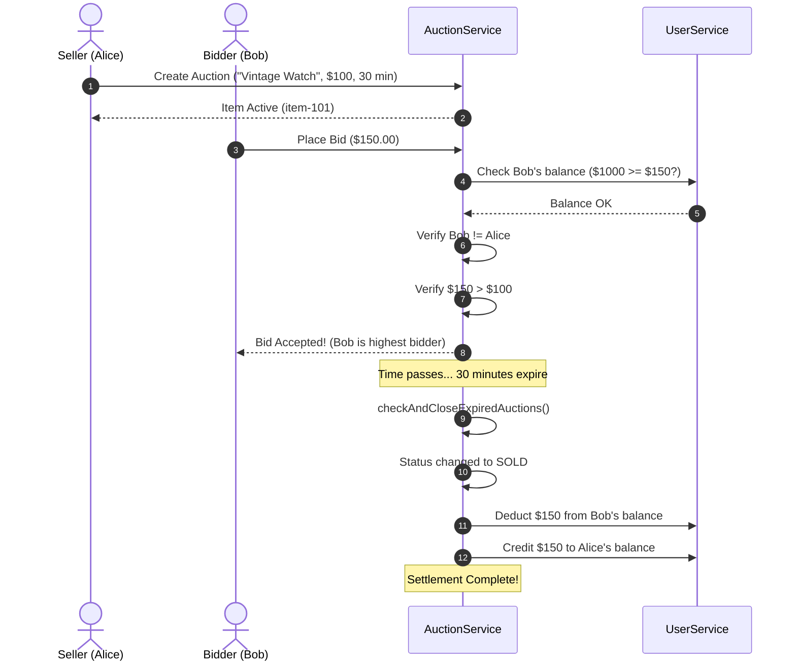

# Online Auction System — How It Works & File Breakdown

> **Project Guide & Presentation Notes**  
> **Repository:** Java Auction  
> **Technologies:** Java (JDK 8+), In-Memory Collections, Object-Oriented Design (OOP), Interactive HTML Dashboard

---

## 1. Quick Summary (What is this project?)

This project is an **Online Auction System** built in Java using fundamental Object-Oriented Programming (OOP) and a clean **3-tier architecture** (Presentation, Business Logic, and Data Models).

It models an eBay/Sotheby's style auction platform where:
1. **Users** register, log in, deposit funds, and manage an in-app wallet balance.
2. **Sellers** can list items with starting prices and countdown durations.
3. **Bidders** can search for items, inspect details, and place competitive bids.
4. **The System** enforces business rules (no self-bidding, bids must beat the highest offer, balance checks) and automatically settles auctions upon expiration (deducts funds from the winner and credits the seller).

Two interfaces are provided:
- **Terminal UI (`AuctionApp.java`)**: Pure Java CLI menu driven by `Scanner`.
- **Visual Web UI (`index.html`)**: An interactive dashboard with real-time countdowns, wallet switcher, and bid management for visual presentations and demonstrations.

---

## 2. File-by-File Detailed Breakdown

Here is what **every single file** in `src/` and the root folder is doing:

```
Java Auction/
│
├── index.html                  # 🎨 Interactive visual web dashboard (live demo)
├── ARCHITECTURE.md             # 📐 Architecture, class diagrams, and state machines
├── HOW_IT_WORKS.md             # 📖 Detailed guide and presentation script (this doc)
│
└── src/
    ├── AuctionStatus.java      # 🏷️ Enum defining valid states of an auction
    ├── User.java               # 👤 Data Model for a registered participant
    ├── AuctionItem.java        # 📦 Data Model for an item listed for auction
    ├── Bid.java                # 💰 Data Model for a single bid entry
    │
    ├── UserService.java        # ⚙️ Business Service for user accounts & wallet
    ├── AuctionService.java     # ⚙️ Business Service for bidding & settlement
    ├── NotificationService.java# 🔔 In-memory alerts and message dispatcher
    └── AuctionApp.java         # 🖥️ Main Console Entry Point & Text UI
```

---

### File 1: `AuctionStatus.java` (Enum)
- **What it is:** A Java enumeration that defines the 4 lifecycle states of any auction item.
- **Values:**
  - `ACTIVE`: Currently live; accepting bids within its time window.
  - `SOLD`: Time expired and at least one qualifying bid was placed.
  - `UNSOLD`: Time expired with zero bids placed.
  - `CANCELLED`: Closed manually or revoked.
- **Why it matters:** Prevents "magic strings" and guarantees type safety across the entire application.

---

### File 2: `User.java` (Data Model)
- **What it is:** Represents a registered user (buyer, seller, or both).
- **Key Fields:**
  - `userId` (`String` UUID): Immutable, globally unique ID.
  - `username` & `password` (`String`): User credentials.
  - `email` (`String`): Contact address.
  - `balance` (`double`): Digital wallet balance (starts at `$1000.00` by default).
- **Key Methods:**
  - `deposit(double amount)`: Adds funds to the user's wallet.
  - `withdraw(double amount)`: Safely subtracts funds if sufficient balance exists; returns `false` otherwise.
- **Design Note:** Kept clean as a pure Plain Old Java Object (POJO) with encapsulation (private fields + getters/setters).

---

### File 3: `AuctionItem.java` (Data Model)
- **What it is:** Represents a specific product put up for auction.
- **Key Fields:**
  - `itemId` (`String` UUID): Unique auction identifier.
  - `sellerId` (`String`): The `userId` of whoever created the listing.
  - `title` & `description`: Item description and specifications.
  - `startingPrice` (`double`): The minimum allowed opening bid.
  - `currentHighestBid` (`double`): Tracks the current leading price.
  - `currentHighestBidderId` (`String`): The `userId` of who holds the top bid (`null` if no bids yet).
  - `startTime` & `endTime` (`LocalDateTime`): The active time window calculated from duration minutes.
  - `status` (`AuctionStatus`): Initialized to `ACTIVE`.
- **Key Methods:**
  - `isExpired()`: Checks if `LocalDateTime.now().isAfter(endTime)`.
  - `getRemainingSeconds()`: Computes remaining seconds for countdown formatting.

---

### File 4: `Bid.java` (Data Model)
- **What it is:** An immutable transaction record of a single bid attempt.
- **Key Fields:**
  - `bidId` (`String` UUID): Unique transaction identifier.
  - `itemId` (`String`): Which item was bid on.
  - `bidderId` (`String`): Who placed the bid.
  - `amount` (`double`): Bid dollar value.
  - `timestamp` (`LocalDateTime`): Exact timestamp when the bid occurred (`LocalDateTime.now()`).
- **Why it matters:** Provides a full audit trail for the **Bid History** feature.

---

### File 5: `UserService.java` (Business Logic Layer)
- **What it is:** The centralized manager for all user accounts and wallet operations.
- **Internal Storage:**
  - `Map<String, User> users`: Fast $O(1)$ lookups by `userId`.
  - `Map<String, String> usernameToId`: Index to ensure username uniqueness and support login by username.
- **Key Methods:**
  - `register(username, password, email)`: Validates that the username isn't taken, creates a new `User`, and stores it.
  - `login(username, password)`: Verifies username existence and checks password match.
  - `deposit(userId, amount)`: Validates positive amount and increments user wallet.
  - `getUserById(userId)` & `getUserByUsername(username)`: Query methods.

---

### File 6: `AuctionService.java` (Core Engine)
- **What it is:** The heart of the application. It handles listing creation, bid validation, querying, and settlement.
- **Internal Storage:**
  - `Map<String, AuctionItem> auctions`: Stores all auctions by `itemId`.
  - `Map<String, List<Bid>> bidsMap`: Stores the bid history ledger for each `itemId`.
- **Key Methods & Logic:**
  - `createAuction(sellerId, title, desc, price, durationMinutes)`:
    - Instantiates a new `AuctionItem` with end time = `now() + durationMinutes`.
    - Initializes an empty bid history list.
  - `placeBid(itemId, bidderId, amount, userService)`:
    - Executes **6 strict business rules**:
      1. Does the item exist?
      2. Is status still `ACTIVE`?
      3. Is the current time before `endTime`?
      4. Is the bidder someone else? (Seller cannot bid on their own item).
      5. Is `amount > currentHighestBid`?
      6. Does the bidder have at least `amount` in their wallet?
    - If all 6 pass: creates `Bid`, appends to `bidsMap`, updates `currentHighestBid` and `currentHighestBidderId`.
  - `checkAndCloseExpiredAuctions(userService)`:
    - Automatically scanned periodically or before displaying menus.
    - If an active auction has passed `endTime`:
      - **If bids exist:** marks as `SOLD`, deducts winning price from winner's wallet, and deposits that exact amount into the seller's wallet.
      - **If no bids:** marks as `UNSOLD`.
  - Query methods: `getActiveAuctions()`, `searchAuctions(keyword)`, `getWonAuctions(userId)`, `getBidsForItem(itemId)`.

---

### File 7: `NotificationService.java` (Alerts)
- **What it is:** An in-memory notification queue.
- **How it works:**
  - Stores a map of `userId -> List<String>`.
  - `addNotification(userId, message)` pushes an alert (e.g. "You were outbid!", "Your item sold!").
  - `getNotifications(userId)` returns all pending messages and clears the queue (read-once semantics).

---

### File 8: `AuctionApp.java` (Presentation Layer)
- **What it is:** The console user interface containing `public static void main(String[] args)`.
- **How it works:**
  - Runs a continuous loop with a text-based menu.
  - Pre-seeds demo data (`alice` with a Vintage Watch, `bob` with a Gaming Laptop).
  - Handles user inputs with input sanitization (`readLine()` wrapper prevents scanner newline skipping).
  - Formats tables, remaining time (e.g., `0h 29m 45s`), and wallet balances cleanly.

---

### File 9: `index.html` (Interactive Web Dashboard)
- **What it is:** A standalone single-page visual UI created so you can showcase the system in a browser instead of just the terminal.
- **Features:**
  - Live user switching between Alice, Bob, and Charlie.
  - Live wallet balances with deposit modal.
  - Active auction grid with real-time countdown tickers.
  - Bid placement with instant error toast notifications (e.g., self-bidding prevention, insufficient balance).
  - Automatic auction expiration simulation (settles winners and transfers funds).
  - Tabs for **Browse**, **Create Listing**, **My Listings**, **Won Items**, and **Global Bid Ledger**.

---

## 3. End-to-End Workflow: How an Auction Works



---

## 4. Key Design Patterns & Principles Used

1. **Separation of Concerns (SoC):**
   - The UI classes (`AuctionApp.java`, `index.html`) know *how to display* information.
   - The Service classes (`AuctionService.java`, `UserService.java`) know *the business rules*.
   - The Model classes (`User`, `AuctionItem`, `Bid`) hold *the state*.

2. **Non-Locking Bidding Model:**
   - Money is **not** subtracted from bidders while the auction is ongoing. This ensures losing bidders don't have their cash locked up.
   - Deduction happens atomically during the **Settlement Phase** (`SOLD` state).

3. **Defensive Validation:**
   - Every bid goes through 6 checks before mutation occurs.
   - Every balance modification checks for positive numbers and overdrafts.

---

## 5. How to Run Everything

### Running the Terminal Java Application
Open your terminal inside `c:\Users\ME\Desktop\Adithya\Java Auction`:
```bash
# Compile with Java 8 compatibility
javac -source 1.8 -target 1.8 -d bin src/*.java

# Run the console app
java -cp bin AuctionApp
```

### Running the Visual Web Dashboard
Simply double-click:
`c:\Users\ME\Desktop\Adithya\Java Auction\index.html`  
*(Or open it in Chrome, Edge, Firefox, or Safari)*.

---

## 6. Presentation Script / Cheat Sheet (For your slides)

If you are giving a presentation, you can structure your talk in 4 simple slides:

- **Slide 1: Problem & Objective**
  - "Traditional commerce is static. We designed an event-driven, time-bound Online Auction Platform in Java where prices dynamically discover true market value through competitive bidding."
- **Slide 2: Architecture & File Organization**
  - "We divided the project into 3 clean layers:
    1. **Domain Models**: `User`, `AuctionItem`, `Bid`, and `AuctionStatus`.
    2. **Core Services**: `UserService` managing credentials/wallets, and `AuctionService` enforcing 6-step bidding validations and settlements.
    3. **Presentation Layer**: A CLI text-terminal interface alongside an interactive Web Dashboard (`index.html`)."
- **Slide 3: Bidding & Settlement Lifecycle**
  - "An auction moves from `ACTIVE` to either `SOLD` or `UNSOLD`. Bids are recorded with timestamps. When the timer hits zero, the settlement engine automatically debits the winning bidder and credits the seller."
- **Slide 4: Live Demo**
  - Switch to `index.html` or run `java -cp bin AuctionApp`.
  - Show placing a bid as Bob on Alice's Vintage Watch.
  - Show the validation error if Bob tries to bid more than his balance, or if Alice tries to bid on her own item.

