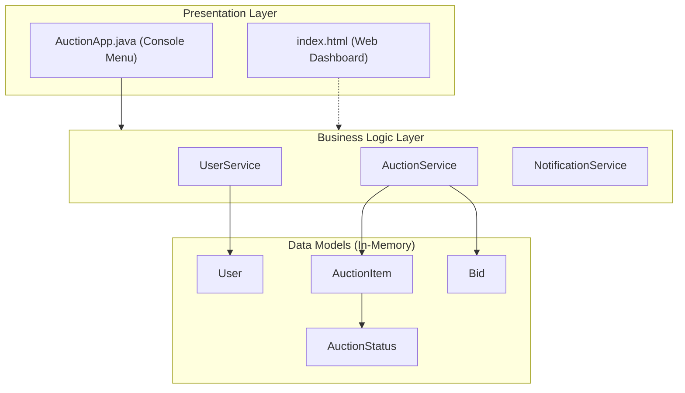

# 🔨 Online Auction System (Java)

[](https://www.oracle.com/java/)
[](LICENSE)
[](#architecture)
[](#user-interfaces)

A complete basic-to-intermediate **Online Auction System** built in pure Java with clean Object-Oriented Programming (OOP) design, paired with a companion interactive Web Dashboard for presentations and visual demonstrations.

---

## 🌟 Highlights & Features

- **User & Wallet Management**: Register, log in, check digital wallet balances, and deposit funds.
- **Auction Engine**: List items with custom starting prices and duration countdowns.
- **6-Point Bidding Validation**:
  1. Verifies auction exists and is `ACTIVE`.
  2. Ensures auction hasn't expired.
  3. Prevents sellers from bidding on their own listings.
  4. Requires bids to strictly exceed current highest bids.
  5. Validates bidder has sufficient balance.
  6. Tracks full bid audit trail with timestamps.
- **Automated Settlement (Auto-Close)**: Once time expires, the engine automatically flags the item as `SOLD` (or `UNSOLD`), deducts funds from the winning bidder, and credits the seller's wallet.
- **Dual Interface**:
  - **Terminal / CLI**: Pure Java text menu driven by `Scanner`.
  - **Visual Web UI**: Standalone interactive HTML5 dashboard with live countdown timers and simulated multi-user bidding.

---

## 🚀 How to Run

### Prerequisites
- **Java JDK 8 or higher** (`javac` and `java` installed and available on your PATH).
- *(Optional)* Any modern web browser (Chrome, Edge, Firefox, Safari) to view the Web UI.

---

### Option 1: Running the Java Console App

1. Open your terminal or PowerShell and navigate to the project root:
   ```bash
   cd "Java Auction"
   ```

2. Compile all Java source files into the `bin/` directory:
   ```bash
   # Standard compile:
   javac -d bin src/*.java

   # Or targeting Java 8 compatibility:
   javac -source 1.8 -target 1.8 -d bin src/*.java
   ```

3. Launch the application:
   ```bash
   java -cp bin AuctionApp
   ```

4. **Pre-seeded Demo Accounts** (ready to test immediately):
   | Username | Password | Role | Starting Balance |
   |---|---|---|---|
   | `alice` | `pass123` | Seller of "Vintage Watch" | $1,000.00 |
   | `bob` | `pass456` | Seller of "Gaming Laptop" | $1,000.00 |

---

### Option 2: Running the Interactive Web UI

No server setup or Node.js required!

Simply **double-click [`index.html`](index.html)** in file explorer, or open it directly in your browser:
```bash
# On Windows PowerShell:
start index.html
```

- Switch live between accounts (`Alice`, `Bob`, `Charlie`).
- Watch live countdown timers.
- Place bids and see real-time error toasts or success settlement.

---

## 📂 Project Structure

```
Java Auction/
│
├── src/
│   ├── AuctionApp.java          # CLI entry point, menu loops, and table rendering
│   ├── User.java                # Data model for users & digital wallet
│   ├── AuctionItem.java         # Data model for auction items & countdowns
│   ├── Bid.java                 # Immutable bid record with timestamps
│   ├── AuctionStatus.java       # Enum: ACTIVE, SOLD, UNSOLD, CANCELLED
│   ├── UserService.java         # Business service for registration, login, wallet
│   ├── AuctionService.java      # Business service for bidding & auto-settlement
│   └── NotificationService.java # In-memory notification queue
│
├── bin/                         # Compiled bytecode (.class files)
├── index.html                   # Interactive visual web dashboard
├── ARCHITECTURE.md              # System design diagrams, state machine, UML
├── HOW_IT_WORKS.md              # Step-by-step logic breakdown & presentation script
├── LICENSE                      # MIT License
└── README.md                    # Project documentation
```

---

## 🏗️ Architecture Overview

The system follows a clean **3-Layer Architecture**:



For full class diagrams, state machines, and sequence diagrams, refer to [**`ARCHITECTURE.md`**](ARCHITECTURE.md).  
For presentation notes and file-by-file explanations, see [**`HOW_IT_WORKS.md`**](HOW_IT_WORKS.md).

---

## 📄 License

This project is licensed under the [MIT License](LICENSE) - feel free to use, modify, and distribute it for academic or personal projects.

